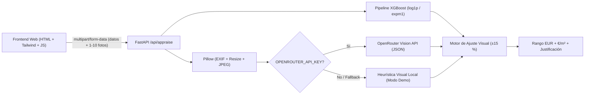

<p align="center">
  
</p>

# CalCasa · Tasador Inmobiliario Multimodal (Madrid)

Aplicación web full-stack de **tasación inmobiliaria inteligente** que combina **Machine Learning tabular (`XGBoost` + `scikit-learn`)** con **análisis visual multimodal vía Gemini / OpenRouter API** para estimar el rango de precio de viviendas en Madrid, su valor por m² y una justificación breve basada en las fotografías aportadas.

> **Autor:** Rubén García Núñez  
> **Demo en vivo:** [https://calcasa.onrender.com/](https://calcasa.onrender.com/) *(Modo Demo Local + BYOK)*  
> **Licencia:** MIT ([`LICENSE`](LICENSE))  
> **Stack:** FastAPI · Tailwind CSS · Vanilla JS · XGBoost · scikit-learn · Pillow · Gemini / OpenRouter API · pytest

---

## ¿Por qué este enfoque híbrido funciona tan bien?

Entrenar una red neuronal multimodal desde cero con miles de fotos inmobiliarias requiere gran volumen de datos etiquetados, GPU dedicada y una arquitectura pesada difícil de mantener. En su lugar, este proyecto separa el problema en dos fases complementarias:

1. **Modelo tabular clásico (`XGBoost`)**: estima el **precio base de mercado** a partir de distrito, superficie, habitaciones, baños, planta, ascensor, orientación exterior, terraza y garaje, incorporando variables derivadas (`m2_por_habitacion`, `sin_ascensor_planta_alta`, `es_bajo`).
2. **Auditoría visual en la nube (`OpenRouter` / `Gemini`)**: envía de **1 a 10 fotografías** normalizadas (`1024 px` hasta 4 fotos, `768 px` entre 5 y 10 fotos, formato JPEG) a un modelo visión-lenguaje solicitando un **JSON estructurado** con puntuaciones del `1` al `10` en **reforma**, **calidades** y **luminosidad**, puntos fuertes, aspectos mejorables y justificación en español.
3. **Motor de ajuste transparente**: pondera las puntuaciones visuales (`45 %` reforma, `30 %` calidades, `25 %` luminosidad) y aplica un ajuste de hasta **`±15 %`** sobre el precio base tabular, devolviendo un rango de mercado realista redondeado a múltiplos de `500 €`.

> **Modo Demo Local + BYOK ("Usa tu propia API Key"):** Si no hay ninguna clave configurada en el servidor (como en una demo pública en internet), la aplicación funciona en **Modo Demo Local** con heurística Pillow y cero consumo de API del autor. Cualquier visitante puede abrir en la interfaz el desplegable *"Usar tu propia API Key (opcional)"* para probar el análisis multimodal real con su propia clave de **Gemini**, **OpenRouter**, **OpenAI** o **Claude** de forma puntual por petición HTTP (nunca se guarda en el servidor ni en `localStorage`).

---

## Arquitectura



Más detalle matemático y de diseño en [`docs/architecture.md`](docs/architecture.md).

---

## Métricas reales del modelo tabular (Kaggle Madrid)

Entrenado con `scripts/train_model.py` sobre **`21.551` viviendas reales limpias** de `houses_Madrid.csv` (Kaggle *Madrid real estate market*), cubriendo **20 distritos y 126 micro-barrios** de Madrid (división estratificada `80 % train = 17.240 / 20 % test = 4.311` + validación cruzada `5-fold`):

| Modelo (Holdout 4.311 viviendas) | R² | MAPE | MedAPE | MAE | RMSE |
| --- | --- | --- | --- | --- | --- |
| `Ridge (Baseline)` | `-3.5777` | `19.51 %` | `14.20 %` | `157.019 €` | `1.447.394 €` |
| `HistGradientBoosting` | `0.9084` | `14.58 %` | `11.11 %` | `98.143 €` | `204.787 €` |
| **`XGBoost (Seleccionado)`** | **`0.9101`** | **`14.42 %`** | **`11.04 %`** | **`96.029 €`** | **`202.811 €`** |

- **Validación cruzada 5-Fold (`XGBoost` sobre entrenamiento):** `R² = 0.9131` · `MAPE = 14.46 %`.
- **Variables con mayor peso en XGBoost:** Ubicación (Distrito y Micro-barrio) **`75,2 %`** · Superficie y distribución **`9,3 %`** · Baños **`9,3 %`** · Planta y ascensor **`4,2 %`** · Tipología / Estado / Extras **`2,0 %`**.
- **Actualización temporal transparente (`×1.35`):** dado que el snapshot público de Kaggle recoge anuncios de 2020, las métricas se evalúan estrictamente sobre los precios reales originales del dataset y en inferencia se aplica un factor configurable (`--market-factor 1.35`) para reflejar el mercado residencial de Madrid en 2026.
- El artefacto serializado [`models/price_model.joblib`](models/price_model.joblib) ocupa **~519 KB** (`531.745` bytes), por lo que puede versionarse en GitHub sin Git LFS.
- La incertidumbre estadística del rango final se calibra a partir del `MedAPE` de validación (acotado entre `±4,5 %` y `±8,5 %`).

---

## Estructura del repositorio

```text
tasador-inmobiliario-multimodal/
├── .dockerignore                   # Excluye .env, .venv, tests y CSVs pesados de la imagen
├── .env.example                    # Variables de entorno y modelo OpenRouter / Gemini
├── .github/workflows/ci.yml        # CI automático: ruff + pytest + build & healthcheck Docker
├── .gitignore
├── Dockerfile                      # Imagen multi-stage lista para Render / HF Spaces / Cloud Run
├── LICENSE                         # Licencia MIT (Rubén García Núñez)
├── pyproject.toml                  # Metadatos del paquete, pytest y ruff
├── requirements.txt                # Dependencias reproducibles
├── README.md
├── data/
│   ├── README.md                   # Guía de esquema y datasets reales de Kaggle
│   ├── raw/                        # CSVs originales de Kaggle (ignorados en git)
│   └── processed/
│       └── madrid_housing_sample.csv
├── docs/
│   └── architecture.md             # Diseño técnico y fórmulas de valoración
├── models/
│   ├── README.md
│   ├── comparables_index.json.gz   # Índice anonimizado de testigos reales de Madrid
│   ├── model_metadata.json         # Métricas reales y medianas €/m² por distrito
│   └── price_model.joblib          # Pipeline sklearn + XGBoost entrenado
├── scripts/
│   ├── generate_madrid_dataset.py  # Generador reproducible (seed=42)
│   └── train_model.py              # Entrenamiento compatible con Kaggle Madrid CSV
├── src/tasador/
│   ├── config.py                   # Configuración tipada con pydantic-settings y BYOK
│   ├── main.py                     # API FastAPI y servidor de archivos estáticos
│   ├── schemas.py                  # Modelos Pydantic de entrada/salida
│   ├── ml/
│   │   ├── features.py             # 20 distritos + 126 barrios e ingeniería de características
│   │   └── predictor.py            # Carga del modelo, contrafactuales y comparables
│   ├── services/
│   │   ├── appraisal_service.py    # Orquestación y fórmula de ajuste visual
│   │   └── pdf_report.py           # Generación de informe ejecutivo PDF con fpdf2
│   └── vision/
│       ├── heuristic_fallback.py   # Normalización Pillow + Modo Demo Local
│       ├── openrouter_client.py    # Cliente async multimodal (failover + BYOK)
│       └── prompts.py              # Prompting especializado en tasación Madrid
├── static/
│   ├── favicon.svg                 # Isotipo compacto de 3 fachadas (CalCasa)
│   ├── img/
│   │   └── calcasa-logo.svg        # Logotipo vectorial principal de 7 fachadas
│   ├── index.html                  # Interfaz editorial Tailwind CSS
│   └── js/app.js                   # Drag & drop, simulador, modal, historial y BYOK
└── tests/
    ├── conftest.py
    ├── test_api.py
    ├── test_ml_pipeline.py
    ├── test_valuation_math.py
    └── test_vision_parsing.py
```

---

## Puesta en marcha rápida (Windows PowerShell / Linux / macOS)

### 1. Crear entorno virtual e instalar dependencias

**Windows (PowerShell):**
```powershell
python -m venv .venv
.\.venv\Scripts\Activate.ps1
pip install -r requirements.txt
pip install -e . --no-deps
```

**Linux / macOS:**
```bash
python3 -m venv .venv
source .venv/bin/activate
pip install -r requirements.txt
pip install -e . --no-deps
```

### 2. Configurar variables de entorno (opcional para Modo Demo)

```bash
cp .env.example .env
```
El archivo `.env.example` sigue el esquema estándar compatible con **OpenRouter**, **OpenAI**, **Anthropic (Claude)** y **Gemini**:

```env
OPENROUTER_API_KEY=sk-or-...

OPENAI_BASE_URL=https://openrouter.ai/api/v1
OPENAI_API_KEY=${OPENROUTER_API_KEY}
OPENAI_MODEL=openai/gpt-5.4-mini

ANTHROPIC_BASE_URL=https://openrouter.ai/api
ANTHROPIC_API_KEY=${OPENROUTER_API_KEY}
ANTHROPIC_MODEL=anthropic/claude-haiku-4.5

GEMINI_MODEL=google/gemini-3.8-flash
GEMINI_API_KEY=

VISION_PROVIDER=auto
```

- Con `VISION_PROVIDER=auto` (por defecto): si rellenas `GEMINI_API_KEY`, usa la **API nativa de Google Gemini** (quitando automáticamente el prefijo `google/`); si no, usa **`OPENROUTER_API_KEY`** con `GEMINI_MODEL` (o el modelo configurado); puedes forzar un proveedor concreto cambiando `VISION_PROVIDER` a `gemini`, `openrouter`, `openai` o `anthropic`.
- *(Si dejas las claves vacías o con el marcador `sk-or-...`, la app funcionará automáticamente en **Modo Demo Local**).*

### 3. (Opcional) Regenerar dataset y reentrenar el modelo

El repositorio ya incluye el modelo entrenado listo para arrancar, pero puedes regenerarlo en cualquier momento:

```bash
python scripts/generate_madrid_dataset.py
python scripts/train_model.py
```

### 4. Arrancar la aplicación web

```bash
uvicorn tasador.main:app --reload
```
Abre en tu navegador:
- **Aplicación web:** `http://localhost:8000`
- **Documentación interactiva Swagger (OpenAPI):** `http://localhost:8000/docs`

### 5. Ejecutar los tests

```bash
pytest -v
```

---

## Reentrenar con el dataset real de Kaggle (`houses_Madrid.csv`)

El modelo actual incluido en [`models/`](models/) ya está entrenado con **`houses_Madrid.csv`**, por lo que **no necesitas descargar el CSV para arrancar la aplicación** ni para probarla. El CSV bruto está excluido en `.gitignore` por higiene de repositorio y porque contiene títulos originales de anuncios con direcciones de calle (en su lugar, [`models/comparables_index.json.gz`](models/comparables_index.json.gz) conserva únicamente testigos 100 % anonimizados).

Si quieres reproducir o modificar el entrenamiento desde cero:

1. Busca en Kaggle el dataset **[`Madrid real estate market`](https://www.kaggle.com/datasets?search=Madrid+real+estate+market)** (archivo `houses_Madrid.csv`, `21.742` filas × `58` columnas; se mapean automáticamente `neighborhood_id` → distrito + 126 micro-barrios, `house_type_id`, `sq_mt_built`, `n_rooms`, `n_bathrooms`, `floor`, `has_lift`, `is_exterior`, `has_terrace`, `has_parking`, `has_ac`, `has_storage_room`, `is_renewal_needed`, `is_new_development` y `buy_price`).
2. Coloca el archivo descargado en:
   ```text
   data/raw/houses_Madrid.csv
   ```
3. Ejecuta el script de entrenamiento:
   ```bash
   python scripts/train_model.py --dataset data/raw/houses_Madrid.csv
   ```
*(Puedes ajustar `--market-factor 1.0` para trabajar con precios de 2020 sin actualizar o `--market-factor 1.35` para mercado 2026).*

---

## Docker & Despliegue público (Render)

El proyecto está desplegado en producción en **[https://calcasa.onrender.com/](https://calcasa.onrender.com/)** usando el plan gratuito con Docker de **Render** (`0 €/mes`, sin tarjeta de crédito y con HTTPS automático).

El repositorio incluye un [`Dockerfile`](Dockerfile) multi-stage (`python:3.11-slim`, usuario no-root UID 1000 y `fonts-dejavu-core` para exportar informes PDF con `€`) y un [`.dockerignore`](.dockerignore) que **excluye `.env` y cualquier clave personal**.

```bash
# Construir imagen de producción
docker build -t calcasa .

# Arrancar en Modo Demo Local + BYOK (cero claves del autor en la imagen)
docker run --rm -p 8000:8000 calcasa
```

Cómo funciona en producción:
1. La demo pública arranca directamente en **Modo Demo Local** sin configurar ninguna clave privada del autor (`~320 MB` de RAM).
2. Cada visitante que desee probar el análisis multimodal completo con LLM puede introducir su propia clave desde el bloque **"Usar tu propia API Key (opcional)"** en el formulario web (o vía cabecera `X-Vision-Api-Key`), sin almacenarse en el servidor ni en `localStorage`.
3. En despliegues gratuitos de Render, el servicio entra en reposo tras 15 minutos sin tráfico y tarda unos 30–50 segundos en despertar en la primera visita.

---

## Endpoints de la API

| Método | Ruta | Descripción |
| --- | --- | --- |
| `GET` | `/` | Sirve la interfaz web del tasador |
| `GET` | `/api/health` | Estado del modelo tabular, proveedor visual y soporte `byok_supported` |
| `GET` | `/api/metadata` | Distritos con sus 126 micro-barrios, medianas `€/m²`, tipologías, benchmark e importancias |
| `POST` | `/api/appraise` | Recibe `multipart/form-data` con características y `1–10` fotos (y cabeceras opcionales `X-Vision-Api-Key` / `X-Vision-Provider`); devuelve valoración, factores y testigos comparables |
| `POST` | `/api/report/pdf` | Genera y descarga el informe ejecutivo de tasación en PDF (`fpdf2`) |

---

## Evolución del proyecto (Portfolio)

- [x] Entrenamiento sobre dataset real de Kaggle (`21.551` viviendas limpias de Madrid).
- [x] Jerarquía **Distrito + 126 micro-barrios** y tipología (`Piso`, `Ático`, `Dúplex`, `Casa o chalet`).
- [x] Benchmark comparativo (`Ridge` vs `HistGradientBoosting` vs `XGBoost`), modal de transparencia ML y explicabilidad local por contrafactuales.
- [x] **Testigos comparables reales anonimizados** del mismo barrio en la UI.
- [x] **Simulador interactivo "What-if" de reforma**, historial local (`localStorage`) y **exportación de informe PDF** descargable.
- [x] Soporte **BYOK ("Usa tu propia API Key")** por petición sin exponer claves del autor, pipeline CI con GitHub Actions (`ruff` + `pytest` + build/healthcheck Docker) y `Dockerfile` multi-stage para despliegue público.
