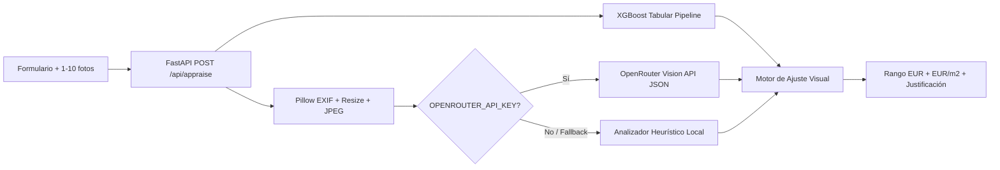

# Arquitectura del Tasador Inmobiliario Multimodal

Autor: **Rubén García Núñez**

## Principio de diseño

Entrenar una red convolucional multimodal extremo a extremo sobre fotografías inmobiliarias exige miles de imágenes etiquetadas, GPU dedicada y una infraestructura pesada. Este proyecto resuelve el problema combinando dos piezas especializadas y desacopladas:

1. **Estimador tabular clásico (`XGBoost` + `scikit-learn`)**: entrenado sobre **`21.551` viviendas reales de Madrid** (`houses_Madrid.csv`), predice el **precio base de mercado** a partir de distrito, **126 micro-barrios**, tipología (`Piso`, `Ático`, `Dúplex`, `Casa o chalet`), superficie, habitaciones, baños, planta, ascensor, exterior, terraza, garaje, aire acondicionado y trastero, más ingeniería de características (`m2_por_habitacion`, `sin_ascensor_planta_alta`, `es_bajo`). Además calcula contribuciones contrafactuales locales por vivienda y aplica un factor de actualización temporal transparente (`×1.35`, 2020 → 2026).
2. **Auditor visual multimodal vía OpenRouter / Gemini**: recibe de 1 a 10 fotografías normalizadas en JPEG (`1024 px` hasta 4 fotos, `768 px` entre 5 y 10 fotos) y devuelve un JSON estructurado con puntuaciones del `1` al `10` en **reforma**, **calidades** y **luminosidad**, además de puntos fuertes, aspectos de mejora y justificación breve en español.

## Flujo de inferencia

## Fórmula transparente del ajuste visual

Cada vivienda recibe un *score visual ponderado* (`S`) entre `1.0` y `10.0`:

$$S = 0.45 \cdot \text{reforma} + 0.30 \cdot \text{calidades} + 0.25 \cdot \text{luminosidad}$$

La puntuación neutra es `5.5` (estado estándar de mercado, ajuste `0 %`). La desviación normalizada respecto al punto neutro escala linealmente hasta `±MAX_VISUAL_ADJUSTMENT_PCT` (`±15 %` por defecto):

$$\text{ajuste (\%)} = \operatorname{clip}\left(\frac{S - 5.5}{4.5}, -1, 1\right) \times 15$$

El precio ajustado se rodea de una banda de incertidumbre (`±4.5 %` a `±8.5 %` según el error mediano absoluto porcentual del modelo tabular en validación) y tanto el precio central como los extremos del rango se redondean a múltiplos de `500 €` para ofrecer una lectura realista de mercado.
